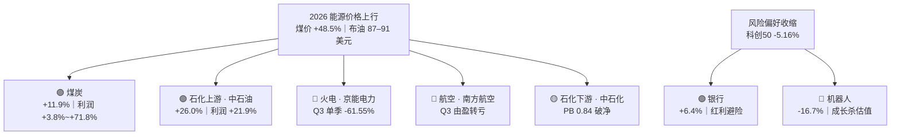

# 索引与横向对比总表

> 快照日期：**2026-11-16**
> 本页是仓库入口。所有数字都可在对应文档中找到来源与日期。

---

## 一、一页看全：已完成的全部分析

### 1.1 板块

| 板块 | **阶段判定** | PE | PB | **2026 至今** | 距区间高点 | 核心矛盾 |
|---|---|---|---|---|---|---|
| [银行](./sectors/银行.md) | **底部出清完成 → 弱复苏初期**（2026-11-17 创 250 日新高） | 7.79 | **0.738** （42/42 破净） | 🟢 **+7.9%** | **-3.81%** | 息差已止跌，但 ROE 仍在下行；距前高仅 3.8% |
| [电力](./sectors/电力.md) | **景气下行初期**（火电） | 25.4 | 待补 | 🟡 +0.6% | -25.83% | 煤价上行 + 电量下滑，股价未反映 |
| [煤炭](./sectors/煤炭.md) | **景气上行中段** | 17.4 | 1.95 | 🟢 **+11.9%** | -13.59% | 煤价涨 48.5%，股价只涨 11.9% |
| [石油石化](./sectors/石油石化.md) | **景气顶部已过 → 下行初段** | 12.6 | **1.37** | 🔴 **-8.6%** | **-33.96%** | 盈利创高新，股价已跌 34% |
| [机器人](./sectors/机器人.md)（概念） | **高位回撤 + 估值消化** | 30.6 / 38.5 | — | 🔴 -16.7% / -18.9% | -25.03% / -26.66% | 从「讲故事」进入「验货」 |

> PE 口径：银行用中证银行 TTM（蛋卷），其余用东财行业板块动态 PE。

### 1.2 个股

| 个股 | **阶段判定** | PE | PB | **2026 至今** | 距区间高点 | 一句话结论 |
|---|---|---|---|---|---|---|
| [中国石油](./stocks/中国石油.md) | **景气高位 + 估值修复完成大半** | 10.99 | 1.40 | 🟢 **+26.0%** | -11.06% | 板块跌 8.6%，它涨 26%，β 失效 |
| [京能电力](./stocks/京能电力.md) | **景气顶部已过 → 下行途中** | 9.86 | 1.27 | 🟡 -2.0% | **-49.32%** | Q3 单季 -61.55%，主体在火电 |
| [南方航空](./stocks/南方航空.md) | **景气下行途中**（油价驱动） | **-16.23** | **3.16** | 🔴 **-35.8%** | -38.0% | 暑运旺季由盈转亏，PE/PB 双双失效 |
| [东方精工](./stocks/东方精工.md) | **主业断档 + 主题退潮** | **3.34（假）** | 1.82 | 🔴 -28.7% | -37.31% | 98% 利润是一次性处置收益 |
| [银龙股份](./stocks/银龙股份.md) | **估值出清 + 盈利拐点存疑** | **11.67** | **1.59** | 🔴 -45.1% | **-51.48%** | 便宜是真的（PE 0 分位/PB 3 分位），但 Q3 单季 -14.9% |
| [福建高速](./stocks/福建高速.md) | **成熟期现金牛 + 类债配置** | **11.71** | **0.80** | 🟡 -6.5% | -23.72% | ROE 仅 6.8%，PB 0.80 是恒等式必然；买点看股息率 |

> 银龙股份、福建高速数据截至 2026-11-17 收盘，其余为 2026-11-16 快照。

---

## 二、阶段分布：它们各自的周期位置

| 周期位置 | 标的 | 共同特征 |
|---|---|---|
| **景气上行** | 煤炭、石化上游（中石油） | 商品涨价直接变利润 |
| **景气顶部已过** | 石油石化板块、京能电力、南方航空 | 股价已跌，盈利滞后见顶 |
| **景气下行** | 电力（火电） | 成本上行、盈利下滑 |
| **底部回升** | 银行 | 最差的时候过去了，但回升极弱 |
| **主题退潮** | 机器人、东方精工 | 故事讲完，等业绩 |
| **估值出清·增长熄火** | 银龙股份 | 便宜是真的，拐点也是真的 |
| **平台期现金牛** | 福建高速 | 无成长、高现金流、靠分红 |

> 🔑 **注意一个规律：本仓库 11 份分析里，「景气上行」只有 2 个，「顶部已过 / 下行」有 5 个，「估值出清但增长熄火」1 个。**
> **这不是巧合 —— 2026 年是能源价格的高位年，多数周期行业都处在「盈利最好但股价先跌」的阶段。**

---

## 三、三条贯穿全仓库的主线

### 主线一：恒等式 $\text{PE} = \dfrac{\text{PB}}{\text{ROE}}$ —— 六个案例全部验证吻合

| 案例 | PB | 年化 ROE | 隐含 PE | 报告 PE |
|---|---|---|---|---|
| 中证银行 | 0.738 | 9.47% | **7.79** | **7.79** ✅ |
| 中国海油 | 1.74 | 18.83% | **9.24** | **9.24** ✅ |
| 中国石化 | 0.84 | 6.23% | **13.48** | **13.56** ✅ |
| 陕西煤业 | 2.51 | 21.3% | **11.8** | **11.80** ✅ |
| 京能电力 | 1.27 | 12.85% | **9.88** | **9.86** ✅ |
| 中国神华 | 2.47 | 13.3% | **18.6** | **18.56** ✅ |

**详见 [`04-PE与PB详解.md`](./docs/04-PE与PB详解.md)。**

### 主线二：ROE ≈ 10% 的破净分界线 —— 20 家真实公司验证

| ROE 区间 | 代表 | PB | 破净 |
|---|---|---|---|
| 29.6% ~ 12.5% | 卫星化学、荣盛、中海油、恒力、中石油、中信证券 | 1.12 – 2.18 | ❌ |
| **≈ 10%** | 工商银行 9.7% | **0.82** | ⚠️ 边界 |
| 7.6% ~ 1.6% | 海油工程、中国石化、宝钢、海螺、保利 | 0.32 – 0.98 | ✅ |

**详见 [`06-破净详解.md`](./docs/06-破净详解.md)。**

### 主线三：2026 「能源涨价年」的赢家与输家

**同一条宏观主线，造就了完全相反的结果。不理解这条主线，就无法解释 2026 年这些板块的分化。**

---

## 四、文件导航

### 方法论（docs/）

| 文件 | 内容 | 什么时候看 |
|---|---|---|
| [`01-板块分类框架.md`](./docs/01-板块分类框架.md) | 申万 / 中信 / GICS 对比 | 想知道「为什么用申万一级」 |
| [`02-申万一级行业板块总表.md`](./docs/02-申万一级行业板块总表.md) | 31 个板块的驱动、指标、估值方法 | **每次分析开始前先看这张** |
| [`03-单板块基本面分析模板.md`](./docs/03-单板块基本面分析模板.md) | 7 维度分析模板 | 要写一份新板块分析 |
| [`04-PE与PB详解.md`](./docs/04-PE与PB详解.md) | 定义、三种 PE 口径、三种死法、恒等式、四象限 | 判断「贵不贵」 |
| [`05-ROE详解.md`](./docs/05-ROE详解.md) | 杜邦分解、五个陷阱、ROIC | 判断「ROE 靠什么来的」 |
| [`06-破净详解.md`](./docs/06-破净详解.md) | PB<1 的含义、三类机会、六步判别 | 看到破净股 |
| [`07-行业估值温度计.md`](./docs/07-行业估值温度计.md) | 127 个申万二级行业 PE/PB 排序 | 想知道「市场当下偏好什么」 |
| [`08-市场风格快照.md`](./docs/08-市场风格快照.md) | 如何读一个「风格切换日」 | 想知道「今天为什么这个涨那个跌」 |
| [`09-仓位与持仓结构框架.md`](./docs/09-仓位与持仓结构框架.md) | 驱动因子分散、风险预算法、哑铃三层配置、MACD 与基本面分工 | 要决定「买多少」而不是「买什么」 |
| [`10-均值回归型资产的买入方法.md`](./docs/10-均值回归型资产的买入方法.md) | 股息锚 / PB 分位 / 偏离度 / 绿柱谷底、金字塔分档、锚失效止损 | 红利/类债「该在什么位置买」 |
| [`11-一页图解两套买卖逻辑.md`](./docs/11-一页图解两套买卖逻辑.md) | 图解速查：有锚 vs 没锚、MACD 正反用、组合结构 | **5 分钟看懂前两篇** |
| [`12-板块关联与轮动.md`](./docs/12-板块关联与轮动.md) | 31 板块压缩成 5 个因子簇、轮动三层机制、三个观察信号 | 判断「这个板块为什么会动」 |

> 市场快照等**带日期的数据报告**不放 docs/，统一归档在 `screening/<批次日期>/`（如 [`screening/2026-11-19/市场快照-2026-11-18.md`](./screening/2026-11-19/市场快照-2026-11-18.md)）。

### 板块（sectors/）· 个股（stocks/）

见上文第一节的两张表，或直接浏览目录。

### 数据（data/）

| 文件 | 内容 |
|---|---|
| [`申万一级行业板块.csv`](./data/申万一级行业板块.csv) | 31 个板块：代码、属性、核心驱动、关键指标、估值方法 |

### 问答（qa/）

| 文件 | 问题 |
|---|---|
| [`2026-11-17-估值指标与股价的关系.md`](./qa/2026-11-17-估值指标与股价的关系.md) | PE / PB 是否随股价实时变化？ROE 与股价什么关系？股价到底是什么？ |
| [`2026-11-17-为什么波动与周期不同.md`](./qa/2026-11-17-为什么波动与周期不同.md) | 为什么有的股票波动大、有的小？为什么涨跌周期有长有短？（含 11 只标的波动率实测） |
| [`2026-11-18-股价为什么会波动.md`](./qa/2026-11-18-股价为什么会波动.md) | 股价波动是「多空博弈」造成的吗？还有哪些原因？（波动来源五层拆解 + 实例） |
| [`2026-11-18-狗队是什么与护盘怎么读.md`](./qa/2026-11-18-狗队是什么与护盘怎么读.md) | 「狗队」指谁？护盘盘面怎么读？护盘日跌停反而增加是为什么？ |
| [`2026-11-18-用修仙境界看投资成长.md`](./qa/2026-11-18-用修仙境界看投资成长.md) | 练气→化神对应哪些投资阶段？掉境界的代价有多大？（**学习路径地图**） |
| [`2026-11-19-中枢预期与风格切换.md`](./qa/2026-11-19-中枢预期与风格切换.md) | 中枢价格能算吗？确定的基本面会推动股价吗（还是提前反映）？风格切换怎么判断？（**六条问题合集**：中枢/预期博弈/清单用法/风格/心态/MACD 手法） |
| [`2026-11-19-个股MACD三段式买点.md`](./qa/2026-11-19-个股MACD三段式买点.md) | 个股的 MACD 买点体系：零轴下方底部金叉 / DIF 上探零轴下方 / 零轴上方金叉，死叉卖出——三个买点逐点辨析与修正（**含顶背离预警与分级卖出**） |
| [`2026-11-19-破心中贼-交易心性的五种贼与破法.md`](./qa/2026-11-19-破心中贼-交易心性的五种贼与破法.md) | 股市为什么是修炼场？「相信自己」该信哪个自己？（**五种心中贼：怕错过/怕认错/拿不住/手痒/事后合理化 + 破法**；含原话留档） |
| [`2026-11-19-日内股价什么时候稳定.md`](./qa/2026-11-19-日内股价什么时候稳定.md) | 一天之内股价什么时候最稳定？开盘/尾盘为什么波动大？（**U 型曲线 + A股日内时段表 + 实操含义**） |
| [`2026-11-19-怎么说服自己买入-综合判断与决策卡.md`](./qa/2026-11-19-怎么说服自己买入-综合判断与决策卡.md) | 怎么说服自己买一只股票？「综合判断」为什么不能当买入依据？（**A/C 层决策卡 + 数勾不数感觉 + 真实数据演示**） |

---

## 五、方法论速查：什么行业用什么指标

| 行业类型 | 代表 | **主指标** | 禁用 / 慎用 |
|---|---|---|---|
| 金融 / 类金融 | 银行、保险、券商、地产 | **PB** + 资产质量 | ⛔ PE（ROE 下行期失真） |
| 强周期 | 煤炭、钢铁、有色、化工、石化 | **PB + 商品价格分位** | ⛔ PE（完全反向） |
| 稳定消费 | 食品饮料、家电 | **PE（分位）** | ⚠️ PB |
| 轻资产成长 | 软件、传媒、互联网 | **PE / PEG / PS** | ⛔ PB |
| 重资产成长 | 半导体、电力设备、军工 | **PE / PEG**，过剩期切 PB | ⚠️ 单看 PB |
| 公用事业 | 电力、水务、高速 | **DCF + 股息率** | ⚠️ 单看 PE |
| **航空** | 三大航 | **EV/EBITDA + PB** | ⛔ PE、⛔ PB（亏损期净资产失真） |
| 亏损 / 微利公司 | 周期底部、创新药 | **PB / PS / EV-EBITDA** | ⛔ PE（负值） |

**详见 [`04-PE与PB详解.md`](./docs/04-PE与PB详解.md) 第五章。**

---

## 六、跨文档最重要的待确认项（按影响排序）

| 优先级 | 缺失项 | 影响的结论 | 出处 |
|---|---|---|---|
| 🔴 **最高** | **10 年期国债收益率** | 银行/红利行情能否持续 —— 整个 [`08`](./docs/08-市场风格快照.md) 的核心变量 | 08 |
| 🔴 **最高** | **各板块 PE/PB 的 5 年 / 10 年历史分位** | 「贵不贵」的纵向标尺 —— 银行、煤炭、石油石化全部缺失 | 银行、煤炭、石油石化、中石油 |
| 🟠 高 | **布伦特原油实时现货价** | 石油石化用的是 EIA **预测值** 87–91 美元，非实时价 | 石油石化、中石油、南方航空 |
| 🟠 高 | **焦煤价格** | 煤炭文档只拿到动力煤数据，焦煤全靠公司利润反推 | 煤炭 |
| 🟠 高 | **航油成本占比 / 美元负债规模 / EBITDA** | 南方航空的油价与汇率杠杆倍数、真实 EV | 南方航空 |
| 🟡 中 | **实现油价与桶油成本** | 中石油的盈利改善里，多少来自油价、多少来自降本 | 中石油 |
| 🟡 中 | **板块成分股全样本与加权方式** | 石油石化的「板块跌 8.6% vs 中石油涨 26%」无法精确归因 | 石油石化、中国石油 |

---

## 七、如何复现与更新（数据源清单）

| 用途 | 接口 |
|---|---|
| 个股 / 板块实时行情、PE、PB | `push2.eastmoney.com/api/qt/stock/get?secid=<市场.代码>` |
| 历史 K 线（日/周/月，可复权） | `push2his.eastmoney.com/api/qt/stock/kline/get` |
| 业绩报表（营收/归母/EPS/BPS/ROE/毛利率） | `datacenter-web.eastmoney.com` → `RPT_LICO_FN_CPD` |
| 资产负债表（总资产/负债/货币资金/负债率） | `datacenter-web.eastmoney.com` → `RPT_DMSK_FN_BALANCE` |
| **申万二级行业估值（PE/PB/PS）** | `datacenter-web.eastmoney.com` → `RPT_VALUEINDUSTRY_DET` |
| 上市公司公告列表 | `np-anotice-stock.eastmoney.com/api/security/ann?stock_list=<代码>` |
| 指数估值历史分位 | `danjuanfunds.com/djapi/index_eva/detail/<指数代码>` |

**更新流程：**

1. 重跑行情与业绩接口，刷新各文档中的数字
2. 重跑 `RPT_VALUEINDUSTRY_DET`，更新 [`07-行业估值温度计.md`](./docs/07-行业估值温度计.md)
3. 对照各文档的「证伪条件」，检查有没有触发
4. 更新本页的横向对比表与快照日期

> ⚠️ **本页所有数字都是 2026-11-16 的快照。方法长期有效，数字会过期。**

---

## 八、仓位含义（仅框架，非建议）

用 [`04-PE与PB详解.md`](./docs/04-PE与PB详解.md) 第七章的「估值 × 基本面四象限」把 11 个标的放进去：

| | **基本面改善** | **基本面恶化** |
|---|---|---|
| **低估值** | ✅ **银行**（PB 0.74、ROE 9.47% 止跌） 煤炭（PB 1.95、煤价强但市场不信持续性） | ❌ 电力·火电（PE 25、盈利下行） 南方航空（亏损、PB 3.16 失真） 银龙股份（PE 11.67、PB 1.59，但 Q3 单季转负） 福建高速（PB 0.80、但处于历史 41 分位，营收 -3.3%） |
| **高估值** | ⚠️ 机器人（PE 30–80，等出货验证） 中国石油（PE 11、但股价已在高位） | ❌ 东方精工（PE 3.34 是假的、主业亏损） |

**四个格子对应四种完全不同的处理方式 —— 这就是整套方法论最终的落点。**
