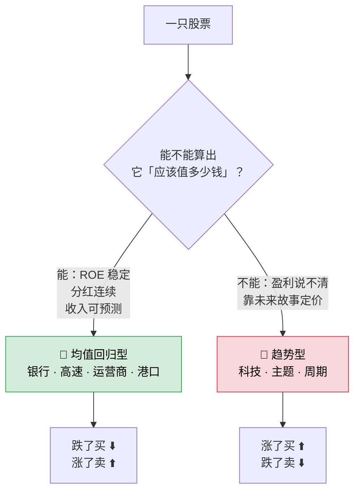
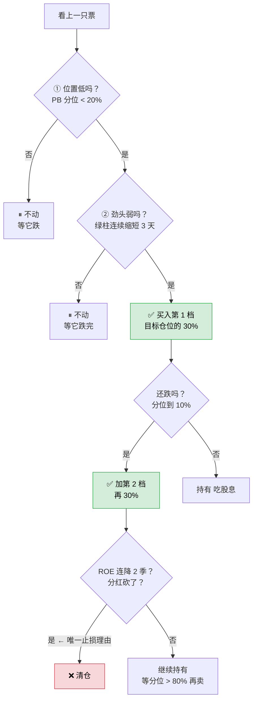
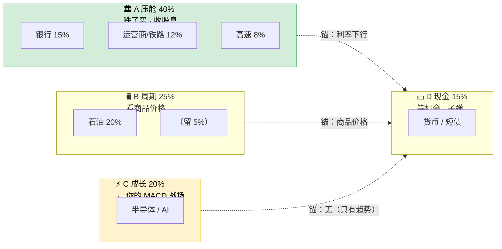

# 一页图解：两套完全相反的买卖逻辑

> 创建日期：**2026-11-18**
> 这是 [`09-仓位与持仓结构框架.md`](./09-仓位与持仓结构框架.md) 和 [`10-均值回归型资产的买入方法.md`](./10-均值回归型资产的买入方法.md) 的**图像化浓缩版**。
> 只想记住一件事的话：**看它「有没有锚」，然后反着做。**

---

## 图 1：全部分歧只有一条岔路



**这就是全部。** 后面所有规则都是这两句话的展开。

---

## 图 2：为什么「均值回归型」可以量出低点

它有一根**橡皮筋**，绑在「合理价」上。趋势型没有。

```text
  价格
   ↑
   │            /\                        /\
   │       /\  /  \      /\              /  \
   │      /  \/    \    /  \            /    \
═══╪═════/════════\══/════\═══════════/══════\═══  ← 合理价（中枢）
   │    /           \/      \         /        \
   │   /                     \       /          \
   │  /                       \     /            \
   └──────────────────────────────────────────────→ 时间
        ↑                            ↑
   偏离中枢下方                  偏离中枢上方
   → 买入（便宜）                → 卖出（贵）
```

**关键：中枢是可以算出来的**

$$\text{合理价} \approx \text{合理 PB} \times \text{每股净资产},\qquad \text{合理 PB} \approx \frac{\text{ROE} - g}{r - g}$$

- $\text{ROE}$ — 公司赚钱能力，财报可查
- $r$ — 市场要求回报率（≈ 10Y 国债 + 风险溢价）
- $g$ — 增长率（高速/银行通常 0%~3%）

**趋势型算不出这个**（$g$ 可能从 0 跳到 100%），所以只能等价格自己证明。

---

## 图 3：同一张 MACD 柱状图，两个方向

你已经会看柱状图了。**只需要把方向反过来。**

### 趋势型（科技）—— 你已经会的

```text
红柱     ▁▂▄▆█▇▅▃▂▁
                  ↑
            红柱开始缩短
              → 卖出 ✂️
```

### 均值回归型（红利）—— 这是镜像

```text
绿柱     ▇▅▃▁▂▄▆█
              ↑
        绿柱开始缩短
          → 买入 🛒
```

| | 趋势型 | **均值回归型** |
|---|---|---|
| 看 | **红**柱（上涨劲头） | **绿**柱（下跌劲头） |
| 劲头**变强** | 买 | —— |
| 劲头**变弱** | **卖** ← 你的规则 | **买** ← 反过来 |
| DIF 在哪 | 零轴**之上** | 零轴**之下很深** |

> ⚠️ 但绿柱缩短**不能裸用**：
> **绿柱缩 + 位置低 = 买；绿柱缩 + 位置高 = 接刀。**

---

## 图 4：实战怎么走



**注意流程里没有「跌了多少」这一项。** 只用两个数：**位置（分位）** 和 **劲头（柱状图）**。

---

## 图 5：为什么「PB 低」不等于「便宜」

这是最容易亏钱的地方，**福建高速**就是反例：

```text
   中国移动                    福建高速
    ROE 7.5%                    ROE 6.8%
    PB  1.64                    PB  0.80
       │                           │
       └──────────┬────────────────┘
                  ▼
        PB = ROE × PE（恒等式）
      PB 低可能只是因为 ROE 低
      而不是因为「打了折」
```

| | PB 分位低 + ROE 平稳/上升 | PB 分位低 + ROE 一直跌 |
|---|---|---|
| 含义 | ✅ **真便宜**（价格偏离，公司没变） | ❌ **价值陷阱**（地板在下沉） |
| 动作 | 买 | 不买 |

---

## 图 6：为什么红利股不能用日线 MACD（一道算术题）

```text
  银行一年给你          3.94%   （股息）
  日线 MACD 一年多响    8-10 次
  每次来回成本          约 0.2%
  ─────────────────────────────
  一年白交             -2.0%
                       ↓
              股息的一半交手续费了
```

**这不是「赚少了」，是「把确定性的收益换成了不确定的价差」。**

---

## 图 7：整个组合长什么样



**你的 MACD 只管黄色那一块（20%）。** 剩下 80% 用别的规则。

---

## 图 8：两种资产的心理难点完全不同

```text
 趋势型                    均值回归型
 买了跌 ↓                  买了跌 ↓
   ↓                         ↓
 「我判断错了 → 止损」      「更便宜了 → 加仓」
   ↓                         ↓
 痛苦但正确                痛苦且反人性 ⚠️
```

**多数人在两种资产上用同一种本能，所以两种都亏：**
- 在趋势型上「越跌越买」→ 补在半山腰
- 在均值回归型上「跌了就砍」→ 卖在最低点

---

## 一页速查表

| 问题 | 趋势型（科技） | 均值回归型（红利） |
|---|---|---|
| **能不能算合理价** | ❌ 不能 | ✅ 能 |
| **什么时候买** | 涨起来（金叉 + 红柱增） | **跌下去（分位低 + 绿柱缩）** |
| **什么时候卖** | 红柱开始缩 | 分位 > 80% |
| **加仓方向** | 越涨越加 | **越跌越加** |
| **止损看什么** | 价格 −2σ | **锚坏了（ROE/分红/政策）** |
| **一年做几次** | 3-5 次 | **1-3 次** |
| **赚什么钱** | 价差 | **股息 + 回归** |
| **最大风险** | 追高 | **价值陷阱** |
| **一句话** | **等它证明自己** | **等它跌过分** |

---

## 三句话总结

1. **有锚的（红利/银行/高速）→ 跌了买，因为算得出合理价。**
2. **没锚的（科技/主题）→ 涨了买，因为只能等趋势自己确认。**
3. **MACD 在两类资产上都用得上，但方向相反：红柱顶卖 → 绿柱底买。**

> 详细推导见 [`09-仓位与持仓结构框架.md`](./09-仓位与持仓结构框架.md)（配置与仓位）与 [`10-均值回归型资产的买入方法.md`](./10-均值回归型资产的买入方法.md)（买入信号与止损）。
