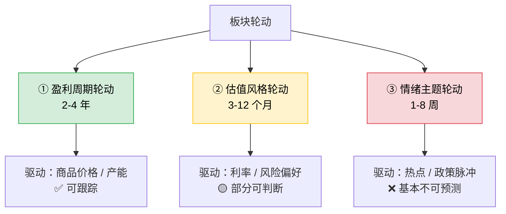
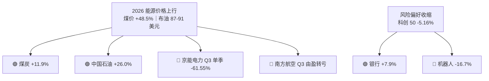

# 板块关联与轮动：31 个板块，其实只有 5 个仓位

> 创建日期：**2026-11-18**
> 起因：各板块之间是否有关联？是否存在轮动？
> 数据来源：[`../data/申万一级行业板块.csv`](../data/申万一级行业板块.csv)（31 板块的 style/core_driver 字段）、[`07-行业估值温度计.md`](./07-行业估值温度计.md)（2026-11-16 快照）、[`08-市场风格快照.md`](./08-市场风格快照.md)、[`../INDEX.md`](../INDEX.md)
> 关联：[`09-仓位与持仓结构框架.md`](./09-仓位与持仓结构框架.md)、[`10-均值回归型资产的买入方法.md`](./10-均值回归型资产的买入方法.md)、[`11-一页图解两套买卖逻辑.md`](./11-一页图解两套买卖逻辑.md)

---

## 0. 结论先行

$$\boxed{\text{关联} = \text{板块共享同一个自变量};\qquad \text{轮动} = \text{资金在不同的自变量之间搬家}}$$

**三句话：**

1. **有关联，但关联不是"同涨同跌"，而是"共享同一个变量"**——同一个变量对不同板块可以是**反向**的（煤价涨：煤炭赚、火电亏）。
2. **31 个申万一级板块，压缩后只有 5 个独立"仓位"**。买 3 只银行 + 2 只煤炭 + 1 只高速，不是分散。
3. **轮动真实存在，但有三层，时间尺度差 10 倍**：盈利周期轮动（2-4 年，可跟踪）、估值风格轮动（3-12 月，部分可判断）、情绪主题轮动（1-8 周，**基本不可预测**）。

---

## 一、关联的本质：共享一个自变量

板块之间之所以联动，是因为它们的利润表被**同一个变量**驱动。

| 共享变量 | 谁受益（↑） | 谁受损（↑） | 关系 |
|---|---|---|---|
| **① 无风险利率 / 流动性** | 成长股（电子、计算机、军工） | 红利股（银行、公用） | **反向**，此消彼长 |
| **② 商品价格（PPI）** | 上游：煤炭、石油、有色、化工 | 下游：电力、航空、家电 | **反向**：成本转嫁 |
| **③ 地产 / 基建链** | 钢铁、建材、建筑、家电、轻工、银行 | —— | **同向**：一荣俱荣 |
| **④ 出口 / 全球需求** | 电子、家电、机械、纺织 | —— | **同向** |
| **⑤ 政策 / 产业趋势** | 军工、计算机、传媒、电力设备 | —— | **同向，但脉冲式** |

### 1.1 关键洞察：关联 ≠ 同涨同跌

**同一个变量的两个方向，造就完全相反的结果。**

2026 年最干净的例子（来自 [`../INDEX.md`](../INDEX.md)）：

| 板块 | 2026 至今 | 在链条上的位置 |
|---|---|---|
| 煤炭 | **+11.9%** | 煤价↑ → **收入端受益** |
| 京能电力（火电） | **-2.0%**（距高点 **-49.32%**） | 煤价↑ → **成本端受损** |
| 中国石油 | **+26.0%** | 油价↑ → 收入端受益 |
| 南方航空 | **-35.8%** | 油价↑ → 成本端受损 |

> 🔑 **"煤炭和电力同属能源板块" —— 这句话对投资毫无用处，因为在煤价这条变量上，它们是对手盘。**

---

## 二、31 个板块 → 5 个因子簇

用 `data/申万一级行业板块.csv` 的 `style` 与 `core_driver` 字段聚合：

| 簇 | 包含板块 | 共同自变量 | 2026 表现 |
|---|---|---|---|
| **A 红利 / 利率簇** | 银行、非银（部分）、公用事业、交通运输、煤炭（高股息属性） | **10Y 国债、股息率利差** | 银行 **+7.9%** |
| **B 资源 / 商品簇** | 石油石化、煤炭、有色金属、钢铁、基础化工、建筑材料 | **油价 / 煤价 / 金属价 / PPI** | 石油石化 -8.6%，煤炭 +11.9% |
| **C 成长 / 科技簇** | 电子、计算机、通信、传媒、国防军工、电力设备 | **流动性、产业趋势、风险偏好** | 机器人 **-16.7%**、科创 50 **-5.16%** |
| **D 消费 / 内需簇** | 食品饮料、家用电器、社会服务、商贸零售、纺织服饰、医药生物、美容护理 | **社零、竣工、居民收入** | 分化 |
| **E 地产 / 基建簇** | 房地产、建筑装饰、机械设备（部分）、钢铁（部分） | **30 城成交、专项债、新开工** | 偏弱 |

### 2.1 为什么这个压缩很重要

$$\text{31 个申万一级} \ \Rightarrow \ \text{5 个独立风险源}$$

| 你以为的"分散" | 实际的因子暴露 |
|---|---|
| 银行 + 中国移动 + 高速 + 青岛港 | **A 簇 ×1** |
| 煤炭 + 石油 + 有色 | **B 簇 ×1** |
| 半导体 + 计算机 + 军工 | **C 簇 ×1** |

> 🔑 **所以 09 文档里 A 层配 15% + 12% + 8% 看着是三只票，实际是一个仓位——这正是那里说"视为一个仓位，符合 A 层上限"的原因。**

---

## 三、轮动的三层机制



| 层 | 周期 | 机理 | 2026 实例 |
|---|---|---|---|
| **① 盈利周期** | **2-4 年** | 上游涨价 → 中游成本↑ → 下游提价 → 上游回落 | 煤价 +48.5% → 煤炭涨、火电亏、航空亏 |
| **② 估值风格** | **3-12 个月** | 利率↓ → 成长占优；风险偏好收缩 → 红利占优 | 银行 +7.9% vs 机器人 -16.7% |
| **③ 情绪主题** | **1-8 周** | 热点切换、政策脉冲、资金博弈 | 机器人从「讲故事」进入「验货」，回撤 -25% |

### 3.1 为什么"轮动"看起来杂乱

**因为三层同时运行，且方向经常相反。**

```text
  盈利周期：煤炭向上 ────────────────────────→
  风格轮动：     红利向上 ────────────→
  主题轮动：  算力↑ ↓机器人↑ ↓低空↑ ↓ ...
  ────────────────────────────────────────→ 时间
             你看到的板块涨跌 = 三者叠加
```

> **用日线去判断盈利周期，用季度去评价主题行情——都会得出错误结论。** 这和 [`../qa/2026-11-17-为什么波动与周期不同.md`](../qa/2026-11-17-为什么波动与周期不同.md) 的核心结论一致。

---

## 四、用本仓库数据验证

### 4.1 2026 年：一条主线，两种结局



**这张图证明了"关联"的本质：不是同涨同跌，是共享同一个变量、站在链条的不同位置。**

### 4.2 2026-11-16：一天之内完成一次轮动

| 指数 | 当日 |
|---|---|
| 中证红利 | **+1.42%** |
| 银行Ⅱ | **+1.76%** |
| 保险Ⅱ | **+1.50%** |
| 创业板指 | **-4.37%** |
| 科创 50 | **-5.16%** |
| 元件 | **-6.71%** |

$$\underbrace{+1.42\%}_{\text{A 红利簇}} - \underbrace{(-5.16\%)}_{\text{C 成长簇}} = 6.58\text{ pct}$$

**同一天 6.6 个百分点的裂口 = 资金从 C 簇搬到 A 簇。**（详见 [`08-市场风格快照.md`](./08-市场风格快照.md)）

### 4.3 估值温度计：当下的「轮动势能图」

2026-11-16 全样本中位数：**PE 40.7 倍 / PB 3.29 倍**

| | PE 最高（最愿付溢价） | PE 最低（最不愿付溢价） |
|---|---|---|
| 1 | 航天装备Ⅱ **229.9** | 银行Ⅱ **8.1**（PB 0.79） |
| 2 | 数字媒体 **124.0** | 保险Ⅱ **10.6** |
| 3 | 电机Ⅱ **114.3** | 油气开采Ⅱ **11.5** |
| 4 | 地面兵装Ⅱ **110.7** | 基础建设 **11.7**（PB 0.83） |
| 5 | 影视院线 101.5 | 白色家电 13.2 |
| 6 | **半导体 72.0**（PB 10.84） | **煤炭开采 18.3** |

**最高与最低相差 28 倍，全部集中在 C 簇 vs A/B 簇两端。**

$$\text{这个分布本身就是「势能」——高位板块需要更强业绩兑现，低位板块只需不被证伪}$$

> ⚠️ **但"PE 低"不等于"会涨"**：煤炭 PE 18.3 是「盈利太肥」压出来的，不是股价便宜（见 [`../screening/2026-11-17/全历史估值分位.md`](../screening/2026-11-17/全历史估值分位.md) 的「PE 0 分位陷阱」）。

---

## 五、三个可观察的轮动信号

| 信号 | 算法 | 阈值 / 含义 |
|---|---|---|
| **① 风格裂口** | 中证红利 − 科创 50（单日） | **> 5pct = 风格切换日**；连续扩大 = 趋势级切换 |
| **② 估值温度计位移** | 各行业 PE/PB 分位的变化方向 | 高位板块分位开始下移 → 轮动启动 |
| **③ 商品价格 vs 股价背离** | 煤价/油价 vs 对应板块涨幅 | 商品涨、股价不涨 = **市场不信持续性**，是轮动前兆 |

### 5.1 第 ③ 条在 2026 年的现成例子

| 变量 | 变动 | 板块反应 | 判读 |
|---|---|---|---|
| 煤价 | **+48.5%** | 煤炭股价仅 **+11.9%** | 股价没跟满 → 市场怀疑持续性 |
| 布油 | 87-91 美元 | 石油石化板块 **-8.6%** | **商品涨、板块跌** → 典型的顶部特征 |
| 中石油 | 油价上涨 | 个股 **+26.0%** | 板块内部剧烈分化 |

> [`../sectors/石油石化.md`](../sectors/石油石化.md) 的判语是「景气顶部已过 → 下行初段：盈利创高新，股价已跌 34%」——**这正是轮动的领先信号：股价先动，盈利后到。**

---

## 六、对交易的四个启示

### 6.1 分散要看「簇」，不看「名字」

$$\text{买 3 只银行} = \text{1 个仓位};\qquad \text{银行 + 高速 + 运营商} = \text{仍是 1 个仓位（A 簇）}$$

**09 文档的"驱动因子分散"，本质就是"跨簇配置"。**

### 6.2 只做能预测的那一层

| 层 | 该不该下注 |
|---|---|
| 盈利周期轮动（2-4 年） | ✅ **可以**——跟踪商品价格、产能、库存 |
| 估值风格轮动（3-12 月） | 🟡 **可以部分下注**——看利率与裂口 |
| 情绪主题轮动（1-8 周） | ❌ **不要预测**——只用仓位限制和止损 |

### 6.3 用「观察」代替「预测」

不需要预判风格何时切换，只需要看**裂口**：

$$\text{裂口扩大} \Rightarrow \text{切换确认，跟随};\qquad \text{裂口收敛} \Rightarrow \text{切换结束，回归}$$

**这比猜顶部/底部可靠得多，因为裂口是当下可测的。**

### 6.4 🔑 轮动是均值回归型资产的「货源」

这条把本文和 [`10-均值回归型资产的买入方法.md`](./10-均值回归型资产的买入方法.md) 连起来了：

$$\text{轮动} \Rightarrow \text{好资产被错杀} \Rightarrow \text{PB 分位进入低位} \Rightarrow \text{买点出现}$$

| 例子 | 轮动造成的结果 | 是不是买点 |
|---|---|---|
| 银行被资金抛弃 → PB 0.738、42/42 破净 | 股息率 3.94%、利差 2.08% | ✅ **锚没坏，是买点** |
| 火电被煤价挤压 → 京能电力 -49% | ROE 被成本端吃掉 | ❌ **锚坏了，不是买点** |

$$\boxed{\text{同样是"跌了很多"，一个能买、一个不能买 —— 区别在于「锚」是否完好}}$$

---

## 七、一句话总结

$$\text{关联} = \text{共享同一个自变量}\qquad\qquad \text{轮动} = \text{资金在自变量之间搬家}$$

**所以"板块轮动"的本质不是"板块在动"，而是"驱动它的那个变量在动"。**

**看板块涨跌，永远先问：它背后的那个变量，现在在往上还是往下？**

---

## 八、待补充

- [ ] 用东财日线算 31 个申万一级板块的**相关系数矩阵**（近 3 年），验证第五章的"5 个簇"假设是否成立
- [ ] 算「红利 − 科创 50」裂口的历史序列，找出历史上所有 >5pct 的日子，统计其后 20/60 日的风格持续性
- [ ] 建一个「簇内相关性 vs 簇间相关性」的对比：若簇内 ρ>0.8 而簇间 ρ<0.3，"压缩成 5 个仓位"就有硬证据
- [ ] 补商品价格与板块股价的**领先-滞后关系**（煤价领先煤炭股多少周？股价领先盈利多少月？）
- [ ] 把 07 的估值温度计做成**时间序列**（每月一次），画出各簇的估值分位变化，这才是真正的"轮动地图"
- [ ] 验证「股价先动、盈利后到」：用石油石化的历史数据算股价顶 vs 盈利顶的间隔分布
