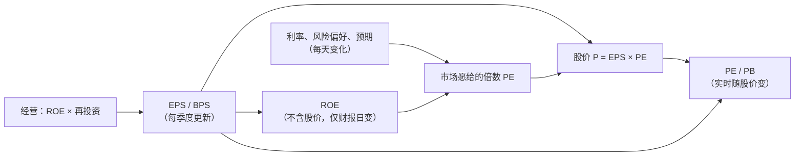

# 问答：估值指标（PE / PB / ROE）与股价的关系

> **提问日期**：2026-11-17
> **问题原文**：
> 「估值、PE、PB、ROE 是不是随时像股价一样变化？如果不变化，是否和股价有一定关系？股价是什么？」
>
> **数据来源**：东方财富公开接口（2026-11-17 抓取），估值口径为 2026-11-16 收盘
> **相关文档**：[`04-PE与PB详解.md`](../docs/04-PE与PB详解.md)、[`05-ROE详解.md`](../docs/05-ROE详解.md)

---

## 一句话结论

**只有股价（P）是实时变量；PE、PB 是「股价 ÷ 财报数字」的商，所以它们跟着股价天天变；ROE 完全不含股价，只在财报日变。**

---

## 一、三者的更新频率完全不同

| 指标 | 分子 | 分母 | 更新频率 | 是否随股价变 |
|---|---|---|---|---|
| **股价 P** | — | — | **每秒** | 它就是本体 |
| **PE** | 股价 | 每股收益 EPS | **每秒**（EPS 每季才换） | ✅ 100% 由股价驱动 |
| **PB** | 股价 | 每股净资产 BPS | **每秒**（BPS 每季才换） | ✅ 几乎 100% 由股价驱动 |
| **ROE** | 净利润 | 净资产 | **每季度一次**（4 次/年） | ❌ **与股价无关** |

结论：**PE 和 PB 的日常波动 = 股价的镜像**，财报数字在两次报告之间是死的。

---

## 二、系统里只有两个自由变量

$$\text{PE} = \frac{P}{\text{EPS}},\qquad \text{PB} = \frac{P}{\text{BPS}},\qquad \text{ROE} = \frac{\text{EPS}}{\text{BPS}}$$

$$P \text{（实时）}\quad + \quad \text{EPS / BPS（每季度更新一次）} \quad \Rightarrow \quad \text{PE、PB、ROE}$$

三者不是独立的，$\text{ROE}$ 是「分子分母同时消掉股价」后剩下的东西：

$$\boxed{\text{PB} = \text{ROE} \times \text{PE}}$$

---

## 三、真实算例：兆易创新（603986）

| 日期 | 股价 | PE(TTM) | PB | **PB ÷ PE（隐含 ROE）** |
|---|---|---|---|---|
| 2026-11-10 收盘 | 244.57 | 14.80 | 2.25 | **15.2%** |
| 2026-11-16 收盘 | 223.22 | 13.51 | 2.05 | **15.2%** |
| 2026-11-17 盘中 | 214.68 | 12.99 | 1.97 | **15.2%** |

股价跌了 **12.2%**，PE 跌 12.2%，PB 跌 12.4%，而 **PB ÷ PE 始终是 15.2%，一动不动**。

> 这就是判断「便宜」必须用 PE 与 PB 双分位交叉验证的原因：
> - 股价下跌 → PE、PB 同比例回落 → 真杀估值
> - 港股/周期股的 PE 低但 PB 高 → 是「盈利暂时很高」，不是股价便宜

---

## 四、股价不动时，PE / PB 什么时候会变

四种情况，本质都是「分母变了」：

| 事件 | 频率 | 影响 |
|---|---|---|
| **财报披露**（一季报 / 中报 / 三季报 / 年报） | 4 次/年 | EPS、BPS 跳变 → PE / PB 一次性跳变 |
| **股本变动**：增发、回购注销、可转债转股、股权激励 | 不定 | EPS、BPS 被动变化 → PE / PB 变，与股价无关 |
| **分红除息** | 1 次/年 | 股价与 BPS 同时下降（PB 基本不变）；PE 因股价跳空而下降 |
| **追溯调整 / 会计政策变更** | 不定 | 历史 EPS、BPS 重述 |

> ⚠️ 亏损公司 PE 失效（E < 0），此时只能看 PB、ROE、PS——例如南方航空 PE 显示 -16.23。

---

## 五、ROE 与股价：因果方向是反的

- ❌ 股价涨 → ROE 变高（错。ROE 里没有 P）
- ✅ ROE 高 → 市场愿意给更高的 PB → 股价更高（对）

$$\text{ROE（经营结果，与股价无关）} \;\rightarrow\; \text{市场给的 PB} \;\rightarrow\; \text{股价} = PB \times BPS$$

**市场定价的从来不是「净资产」，而是「ROE 的水平和可持续性」。**

用 2026-11-17 池子分析中的真实对照：

| 标的 | 隐含 ROE | PE 分位 | PB 分位 | 判读 |
|---|---|---|---|---|
| 兆易创新 | 15.2% | **0%** | **0%** | PE / PB 同处底部 → 真杀估值 |
| 利通电子 | 36.7% | **0%** | **86%** | PE 低是盈利爆发造成的 → 周期顶部陷阱 |

---

## 六、股价到底是什么：三种层次

**1. 会计上：一张索取权凭证**

1 股 = $\dfrac{1}{\text{总股本}}$ 份的净资产 + 未来利润分配权。这是**地板**（PB = 1 的位置）。

**2. 定价上：未来现金流的折现**

$$P = \sum_{t=1}^{\infty} \frac{\text{FCF}_t}{(1+r)^t} \Big/ \text{股本}$$

分子是公司未来能赚多少（由 ROE、再投资能力决定），分母 $r$ 是市场要求的回报率（由利率、风险偏好决定）。这是**中枢**。

**3. 交易上：最后一笔成交价**

$$P_{\text{市价}} = \text{最新一笔成交价},\qquad \text{总市值} = P_{\text{市价}} \times \text{总股本}$$

**边际定价**——全公司几千亿市值，由最后 1 手成交决定。这是**现实**，也是短期波动之源。

---

## 七、传导关系图

---

## 八、三条实用推论

1. **短期（天 / 周）**：PE 在动，EPS 不动 → 看到的涨跌 100% 是估值乘数的变化，与公司经营无关。
   *例：2026-11-17 那份池子分析里 16 只票一周内 PE 掉 8%–18%，三季报数据一个字没变。*

2. **中期（季 / 年）**：PE 的变化是在「抢跑」下一期 EPS。股价先跌、财报后验证——
   这正是 [`INDEX.md`](../INDEX.md) 里「景气顶部已过：股价已跌，盈利滞后见顶」的机制。

3. **长期（3 年+）**：ROE 决定一切。PB 最终收敛到 ROE 对应的合理水平，PE 则取决于 ROE 能维持多久。
   **长期选股看 ROE 趋势，而不是 PE 分位**——只看 PE 分位会掉进「周期顶部低 PE 陷阱」。

---

## 九、待补充

- [ ] 分红除息对 PE / PB 的精确影响算例（含除权价计算）
- [ ] 股本变动（增发 / 回购）导致 PE 偏离股价的实例
- [ ] 用 ROE 与要求回报率 $r$ 推导合理 PB 的公式（戈登模型形式）
